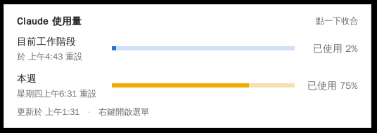

# Claude 使用量浮動視窗

把 claude.ai「設定 → 使用量」裡的 **目前工作階段** 與 **本週** 用量，做成桌面上永遠置頂的小浮動視窗。

| 精簡版（預設） | 點一下展開 |
| --- | --- |
|  |  |

- **精簡版**只顯示兩個數字：藍色是目前工作階段（5 小時），橘色是本週；超過 90% 會變紅。
- **點一下**展開，看到進度條和重設時間；再點一下收合。
- **拖曳**可以移動位置（會記住）；**右鍵**開啟選單（重新整理、隱藏、結束）。
- 每 60 秒自動更新。
- 背景模式下，**偵測到 Claude 啟動就自動跳出，關閉 Claude 就自動隱藏**。

## 需求

- Python 3.8 以上（只用標準函式庫，不用 `pip install`）
- 已登入 **Claude Code**（程式會讀取 Claude Code 的登入資訊，跟 `/usage` 指令用的是同一個來源）

## 安裝

### Windows

1. 安裝 [Python](https://www.python.org/downloads/)（安裝時勾選 **Add python.exe to PATH**）。
2. 下載這個專案，雙擊 **`install_windows.bat`**。

完成後會在「啟動」資料夾建立捷徑，之後每次開機都會在背景待命，開啟 Claude 桌面版或 Claude Code 時自動跳出。
要移除：在命令列執行 `install_windows.bat -Uninstall`。

### macOS

```bash
./install_macos.sh            # 安裝
./install_macos.sh --uninstall  # 移除
```

### 只想直接開來看

```bash
python claude_usage_widget.py          # 直接顯示
python claude_usage_widget.py --demo   # 用假資料預覽外觀
```

## 設定（選填）

把 `config.example.json` 複製成 `config.json` 再修改：

| 欄位 | 說明 |
| --- | --- |
| `process_names` | 要偵測的程式名稱。預設 `claude.exe`、`claude`，涵蓋 Claude 桌面版和 Claude Code |
| `refresh_seconds` | 多久更新一次用量（秒） |
| `process_check_seconds` | 多久檢查一次 Claude 是否啟動（秒） |
| `session_key` | 沒用 Claude Code 時的替代方案：填入 claude.ai 的 `sessionKey` cookie |
| `org_id` | 搭配 `session_key`，帳號有多個組織時指定要看哪一個 |

## 常見問題

**顯示 ⚠「登入已過期」**：Claude Code 的登入權杖會定期更新，打開一次 Claude Code 就會自動續期，視窗下次更新時恢復正常。

**用量和網頁上差 1%**：網頁與 API 的四捨五入時間點不同，屬正常現象。
